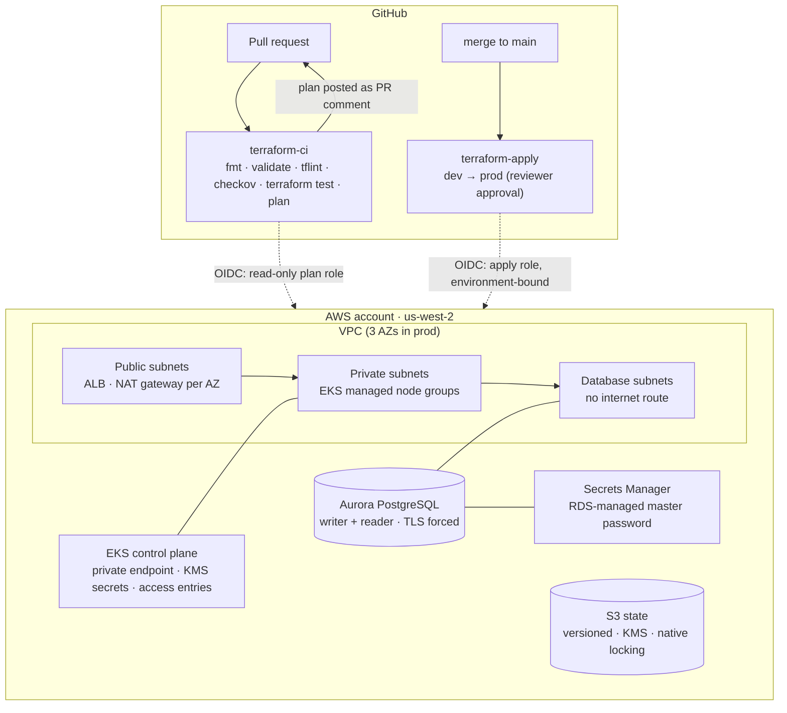

# terraform-aws-platform

[](https://github.com/GauravAnand90/terraform-aws-platform/actions/workflows/terraform-ci.yml)


A reference AWS platform built the way I'd build one for a real engineering org: **reusable Terraform modules** for networking, Kubernetes and databases, **separate dev and prod environments**, and a **GitOps-style pipeline** where every change is linted, security-scanned, tested and planned on the pull request, then applied behind an approval gate.

It's based on patterns I've used running a self-service platform for 100+ developers and migrating enterprise middleware workloads to AWS. It contains no proprietary code.

---

## Architecture



## What's inside

| Path | What it does |
|---|---|
| [`modules/vpc`](modules/vpc) | Three-tier VPC: public / private / isolated database subnets, NAT per AZ (or one in dev), S3 endpoint, flow logs, EKS discovery tags |
| [`modules/eks`](modules/eks) | EKS with private API, KMS-encrypted secrets, access entries instead of `aws-auth`, IMDSv2-only nodes, SSM instead of SSH, Pod Identity + IRSA, managed add-ons |
| [`modules/rds-aurora`](modules/rds-aurora) | Aurora PostgreSQL (provisioned or Serverless v2), RDS-managed rotated password, CMK encryption, forced TLS, SG-only access |
| [`envs/dev`](envs/dev), [`envs/prod`](envs/prod) | Thin roots; identical `main.tf`, differences only in `terraform.tfvars` |
| [`bootstrap`](bootstrap) | One-time setup: state bucket and GitHub OIDC plan/apply roles |
| [`.github/workflows`](.github/workflows) | PR checks and plan comments; gated apply on merge |
| [`modules/vpc/tests`](modules/vpc/tests) | Native `terraform test` with a mocked provider: runs in CI in seconds, no AWS |
| [`test`](test) | Go / Terratest integration test that deploys real infrastructure, asserts and destroys |
| [`docs/adr`](docs/adr) | Architecture decision records |

## Dev vs prod

Same code, different risk and cost trade-offs:

| Setting | dev | prod | Why |
|---|---|---|---|
| Availability zones | 2 | 3 | Prod survives losing an AZ with capacity to spare |
| NAT gateways | 1 shared | 1 per AZ | No cross-AZ egress dependency in prod |
| EKS nodes | Spot, mixed instance types | On-demand + tainted `system` node group | Spot is ~60–70% cheaper; prod isolates critical add-ons |
| Aurora | Serverless v2 (0.5–2 ACU), 1 instance | `db.r6g.large` writer + reader | Dev idles cheaply; prod fails over in seconds |
| Backups | 1 day, no final snapshot | 14 days, final snapshot | Deletion protection is on in both; dev turns it off in a PR before teardown |
| Log retention | 7 days | 90 days | |

**Rough monthly cost (us-west-2, on-demand list prices, before data transfer):** dev ≈ **$200**, prod ≈ **$1,100**. The largest prod items are the Aurora instances and nodes. Run `infracost breakdown --path envs/prod` for a current figure.

## The delivery pipeline

**On every pull request** ([`terraform-ci.yml`](.github/workflows/terraform-ci.yml)):

1. `terraform fmt -check` and `validate` for every module and environment
2. `terraform test` (mocked provider, no credentials)
3. `tflint` with the AWS ruleset
4. `checkov` security scan. It fails the build on any finding that isn't an explicitly documented exception in [`.checkov.yaml`](.checkov.yaml)
5. `terraform plan` for dev **and** prod using a **read-only** role, posted (and kept updated) as a PR comment

**On merge to `main`** ([`terraform-apply.yml`](.github/workflows/terraform-apply.yml)): apply to dev, then prod. Prod waits for a required reviewer on the `prod` GitHub environment, and the IAM trust policy only allows the apply role from jobs in that environment ([ADR 0003](docs/adr/0003-ci-authentication.md)).

There are **no AWS access keys anywhere**; CI uses short-lived OIDC credentials.

## Security defaults

- Private EKS API; cluster access through IAM access entries; no hidden cluster-creator admin
- Kubernetes secrets, Aurora storage, Performance Insights and the DB secret encrypted with customer-managed KMS keys (rotation on)
- IMDSv2 required with hop limit 1, so pods can't read node credentials
- No SSH keys on nodes; SSM Session Manager instead
- Database subnets have no internet route; DB accepts only security-group-referenced traffic, TLS forced
- Default security group locked down; VPC flow logs on
- State bucket: versioned, KMS-encrypted, public access blocked, TLS-only policy

## Getting started

**Prerequisites:** Terraform ≥ 1.10, AWS CLI, an AWS account you can experiment in. Optional: `tflint`, `checkov`, `pre-commit`, Go ≥ 1.24.

```bash
# 1. One-time bootstrap (local state, admin credentials)
cd bootstrap
terraform init && terraform apply
# note the outputs: state_bucket, plan_role_arn, apply_role_arn

# 2. Configure GitHub (Settings → Secrets and variables → Actions → Variables)
#    TF_STATE_BUCKET            = <state_bucket>
#    AWS_PLAN_ROLE_ARN          = <plan_role_arn>
#    AWS_APPLY_ROLE_ARN         = <apply_role_arn>
#    EKS_ADMIN_PRINCIPAL_ARNS   = ["arn:aws:iam::<account>:role/<your-admin-role>"]
#    Create environments "dev" and "prod"; add a required reviewer to "prod".

# 3. Deploy dev locally (or just open a PR and let CI plan it)
make init ENV=dev TF_STATE_BUCKET=<state_bucket>
make plan ENV=dev
make apply ENV=dev

# 4. Connect to the cluster
$(terraform -chdir=envs/dev output -raw kubeconfig_command)
```

**Tear down dev:** set `aurora_deletion_protection = false` in `envs/dev/terraform.tfvars`, apply, then `terraform -chdir=envs/dev destroy`. Deletion protection is on by default everywhere.

## Local checks

```bash
make help         # list targets
make fmt validate # format + validate everything
make lint         # tflint
make security     # checkov
make test         # mocked terraform test, no AWS
make integration  # real-AWS Terratest (creates and destroys a VPC; costs a few cents)
```

Install the git hooks so commits get the same checks as CI: `pre-commit install`.

## Design decisions

- [0001: Modules plus one root per environment](docs/adr/0001-repository-layout.md)
- [0002: Remote state in S3 with native lockfile locking](docs/adr/0002-remote-state.md)
- [0003: CI authenticates with GitHub OIDC and split plan/apply roles](docs/adr/0003-ci-authentication.md)
- [0004: EKS version upgrades](docs/adr/0004-eks-upgrades.md)

## Roadmap

- [ ] ArgoCD bootstrapped onto the cluster (app-of-apps) for workload GitOps
- [ ] Karpenter for node autoscaling
- [ ] AWS Load Balancer Controller and ExternalDNS via Pod Identity
- [ ] Infracost comment on PRs
- [ ] Drift detection: scheduled `plan` that opens an issue on changes

## Author

**Gaurav Anand**: Senior SRE & Platform Engineer · CKA · CKAD · AWS SA Associate · Terraform Associate
[LinkedIn](https://www.linkedin.com/in/gaurav-anand-92767312a) · [GitHub](https://github.com/GauravAnand90)
