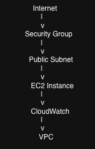

# Terraform AWS Platform

Infrastructure as Code (IaC) project demonstrating AWS resource provisioning using Terraform.

## Technologies

- Terraform
- AWS
- VPC
- EC2
- IAM
- CloudWatch

## Features

- VPC Creation
- Public Subnet Deployment
- Security Group Configuration
- Infrastructure Automation
- Terraform State Management

## Architecture



## Deployment

```bash
terraform init
terraform validate
terraform plan
terraform apply
